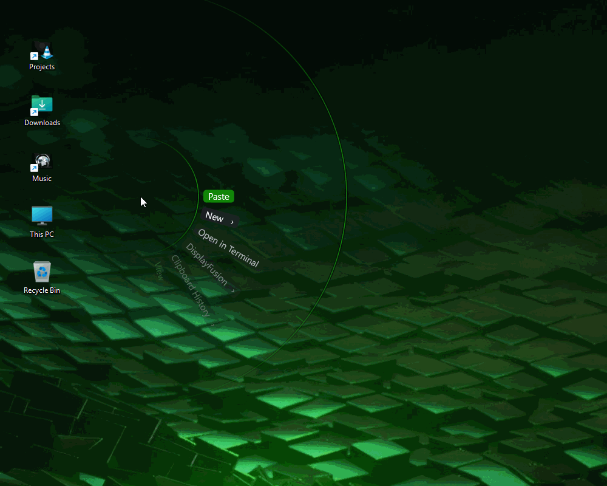

# Wheel Context Menu

A [Windhawk](https://windhawk.net/) mod that shows classic Windows context
menus as a half wheel around the cursor. The item on the centre line, or the
one under the cursor, is highlighted, and items fade out toward the top and
bottom of the arc.

The wheel can be spun, scrolled, typed into and rearranged, and it remembers
what you chose last.

## Install

**From Windhawk** (once the mod is in the catalog): search for
"Wheel Context Menu" and install it.

**From source:**

1. Open Windhawk and choose **Create a New Mod**.
2. Replace the template with the contents of
   [`wheel-context-menu.wh.cpp`](wheel-context-menu.wh.cpp).
3. Compile, then enable the mod.

It needs Windows 10 or 11 and targets `explorer.exe` by default.

## Using it

### Mouse

| Action | Result |
|---|---|
| Move above or below the centre band | Spin the wheel; further out is faster |
| Scroll inside the wheel | Step one item |
| Scroll outside the wheel | Dismiss |
| Click a label | Choose it |
| Click on empty space inside the wheel | Choose the highlighted item (can be set to do nothing, or to close the wheel) |
| Click outside the wheel | Dismiss |
| Press and pull a label | Rearrange; the order is remembered for that menu |
| Right-click inside the wheel | Open the standard menu |

### Keyboard

| Key | Result |
|---|---|
| Type a name | Jump to the matching item |
| Up / Down | Previous / next item (wraps round) |
| Left / Right | Top / bottom of the list |
| Enter | Choose |
| Backspace | Edit what you typed, or go back out of a submenu |
| Esc | Close |

### Submenus

Submenus can be shown three ways:

- **Replace the wheel** swaps the wheel's contents for the submenu.
- **Stack outward** adds each submenu as a new ring outside its parent.
- **Alternate** takes turns between an inner and an outer ring, so the wheel
  never grows past two rings.

## Settings

Everything can be set on the mod's Settings tab in Windhawk. Most of it can
also be changed on the spot from **Wheel options**, the last entry in the
wheel. A choice made there holds until you next change the mod's settings in
Windhawk, which then take over again.

| Setting | What it does |
|---|---|
| Opens toward | Side the arc opens on; it flips by itself at a screen edge |
| Opens on | Item highlighted on open: first, last choice, or Paste after Cut/Copy |
| Recent choices on top | Moves your last few choices to the top |
| Submenus | Replace, stack outward, or alternate |
| Click on empty space | What a click inside the wheel but off any label does: choose the highlighted item, nothing, or close |
| Theme | Dark, light, or match Windows |
| Use the Windows accent color | Colors the outline and highlight with your accent |
| Tilt to spin, speed, response, dead band | How mouse movement spins the wheel |
| Item spacing | Degrees between items |
| Wrap long lists | Let long lists wrap round instead of stopping at the ends |
| Fade out after | Seconds of no input before the wheel fades away |
| Label and edge opacity | How solid the labels are at the centre and toward the ends |
| Text, label and highlight color | Hex colors that override the theme |
| Hidden items | Menu items to leave out, by name, with `*` wildcards |
| Custom items | Extra entries that open a program, document or URL |
| Copy / Paste item names, Never highlight on open | Names used for the Paste-after-Copy behavior and for items that are never pre-highlighted (Delete by default) |

The copy, paste and delete names default to English. Change them if Windows
is set to another language.

## Windows 11

Explorer's modern context menu is not a classic menu, so the wheel appears
only where the classic one would: after **Show more options**, with
Shift + right-click, or everywhere if you restore the classic menu, for
example with the "Classic context menu on Windows 11" mod.

## Other programs

Only `explorer.exe` is targeted by default. Any program that shows classic
menus through `TrackPopupMenu` can be added from the mod's Advanced tab in
Windhawk. Programs that draw their own menus, such as browsers, Office and
most Electron apps, are not affected.

## Other context menu mods

Mods that replace the same menus, such as Custom Cached Context Menu, hook
the same functions. With two of them enabled, whichever hook runs first
takes the menu, so use one at a time.

## Known limits

- Menu icons are not shown.
- A menu whose top level has owner-drawn items with no readable text is
  shown as the standard menu instead. Inside a submenu such items show as
  "Item N".
- Custom items cannot see which file was right-clicked.
- Stacked submenus can run past the screen edge when a menu is deep.

## How it works

The mod hooks `TrackPopupMenu` and `TrackPopupMenuEx`. When a program asks
for a popup menu, the mod reads the items from the menu handle, shows the
wheel in a layered window drawn with Direct2D, and runs it on the calling
thread until you choose or dismiss. Keys come from that thread's own message
queue, as they do for a real menu. Mouse input comes from a low-level hook
that lives on a small thread of its own, so a slow menu handler never holds
up the mouse. The chosen command is then handed back
exactly as the real menu would have returned it. Submenus are read only when
you enter them, after their owner has been told they are about to open, so
lazily filled menus such as "Open with" work.
